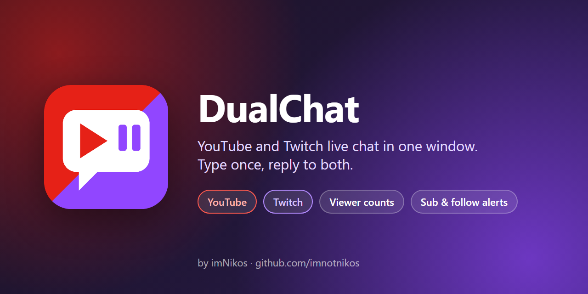

# DualChat
DualChat is a lightweight **Windows** app for streamers who go live on **YouTube** and **Twitch** at the same time. It shows both live chats in one window, and anything you type goes to both. It also shows live viewer counts and pops up an alert for every new sub, member and follower.

***
### App made by imNikos.
 

***

## Features
**One Chat, Both Platforms**: YouTube and Twitch messages appear together, each line tagged and colored by platform.

**One Box Replies to Both**: Type once and press Enter. The message goes to YouTube and Twitch at the same time.

**Live Viewer Counts**: The top bar shows viewers on each platform and the combined total.

**Alerts**: Twitch subs, resubs, gift subs and follows, and YouTube subscribers and members, each pop up for 12 seconds in the top-right corner, always on top. Click a popup to close it early. A gift bomb shows as one popup instead of one per gift.

**Color Emoji**: Emoji, including skin tones, flags and combined emoji, show in full color.

**Light & Dark Mode**: Switch with the **☀ Light / ☾ Dark** button in the top bar. The app remembers your choice.

**Sharp on Any Display**: Text stays crisp at 125%, 150% and higher Windows scaling.

**Low API Usage**: YouTube chat comes in over one connection that stays open instead of constant checking, so a typical stream uses only about 250–350 of YouTube's 10,000 free daily API units per hour.

## Requirements
Windows 10 or 11.

A free Google Cloud project with the YouTube Data API turned on, and a free Twitch developer app. Setup steps are below.

# Installation
## For Streamers
Navigate to the Releases page.

Download the latest `DualChat.exe` and `config.example.json` into the same folder.

Rename `config.example.json` to `config.json` and fill it in (see **Setup**).

Run `DualChat.exe`. On first launch it opens a sign-in page for each platform and shows a code in the chat window. After that, your logins are remembered.

## Setup
In `config.json`, any platform you leave on its `YOUR_...` placeholder is skipped, so you can use just one platform.

### YouTube
1. Go to https://console.cloud.google.com, create a project, and enable **YouTube Data API v3**.
2. Open **Google Auth Platform**, choose **External**, and add your own Google account as a test user.
3. Create an **OAuth client** of type **TVs and Limited Input devices**, and copy its client ID and secret into `config.json`.

### Twitch
1. Go to https://dev.twitch.tv/console/apps and click **Register Your Application**.
2. Set the redirect URL to `http://localhost`, category **Chat Bot**, client type **Public**.
3. Copy the Client ID into `config.json`. Leave `channel` empty to use your own channel.

Start your stream before or after launching. The app checks for a live YouTube broadcast every 60 seconds.

## Good to Know
- Messages are limited to 200 characters, which is YouTube's limit.
- YouTube only reports new subscribers whose subscriptions are **public**, and it can take a few minutes. Member alerts arrive as fast as chat.
- Anyone who already followed or subscribed before you opened the app is ignored. Only new ones get a popup.
- While your Google app is in "Testing" mode, Google signs you out after 7 days, so you'll sign in to YouTube again about once a week.
- Emoji images come from [Twemoji](https://github.com/jdecked/twemoji). Each one is downloaded the first time it appears. Offline, emoji fall back to plain text.
- `config.json` and `tokens.json` hold your keys and logins. Never share or commit them. Both are in `.gitignore`.

## Building
Requires Python 3 with `pillow` and `pyinstaller`.

    pip install pillow pyinstaller
    python -m unittest test_dualchat
    python -m PyInstaller --onefile --windowed --name DualChat --noconfirm --clean --distpath dist --workpath build --specpath build --icon "$PWD\dualchat.ico" --add-data "$PWD\dualchat.ico;." dualchat.py

Output: `dist\DualChat.exe`

Run it from source with `python dualchat.py`. The icon comes from `make_icon.py`, and the banner is `assets/social-preview.html` rendered at 1280×640.

For how it all works and what was fixed along the way, see [REPORT.md](REPORT.md).
